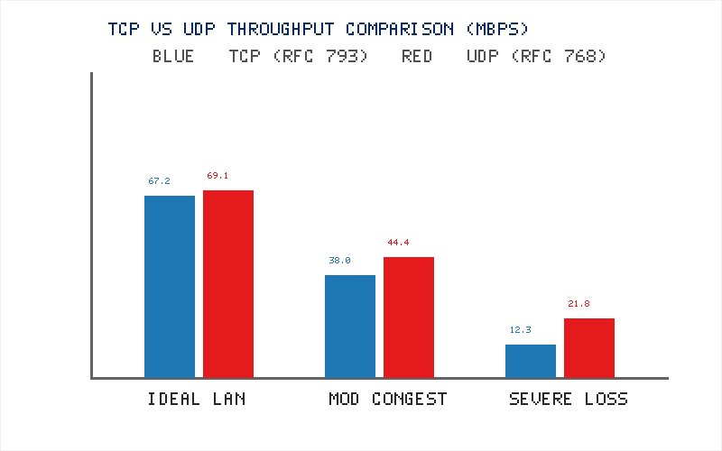
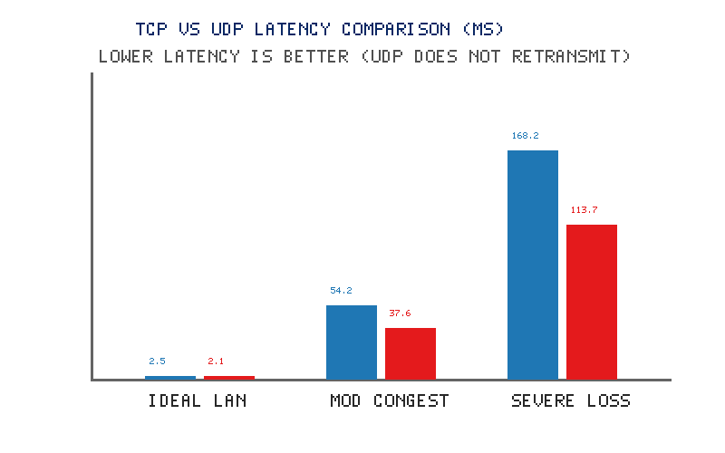
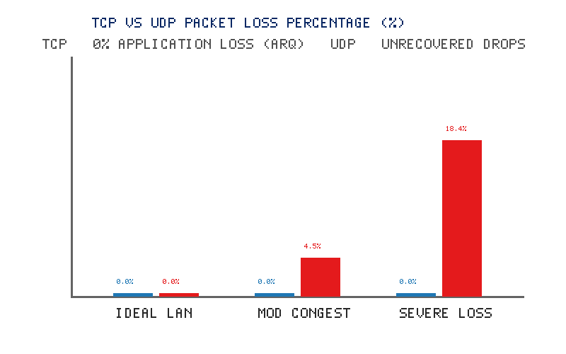
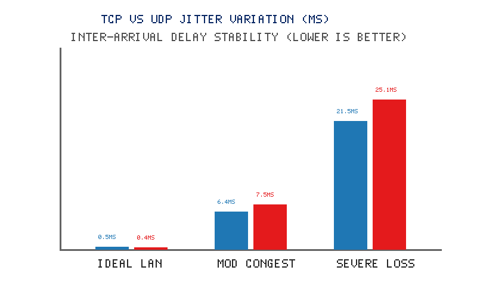
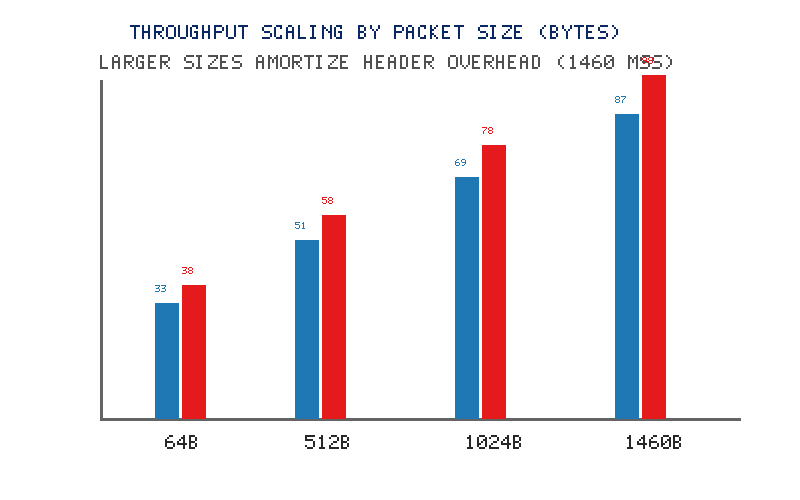
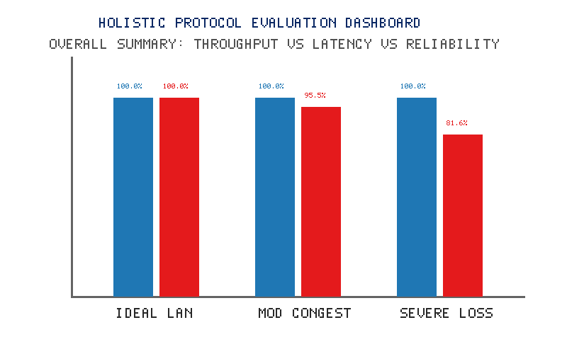

# TCP vs UDP Protocol Performance Analysis Using R Programming

> **Subtitle:** A Comparative Study of Throughput, Latency, Packet Loss, Jitter, and Reliability  
> **Course:** Academic Project in Computer Networks & Computational Data Analytics  
> **Core Disciplines:** Introduction to Data Communication and Computer Networks (IDCCN) &bull; R Programming Language &bull; Computational Data Analytics (CDA)

[](https://arabhishek208.github.io/tcp-vs-udp-performance-analysis/)
[](https://github.com/ARabhishek208/tcp-vs-udp-performance-analysis)
[](https://www.r-project.org/)

---

## 🌐 Live Interactive Web Dashboard
You can run and test the complete interactive simulation and packet capture directly on the web:  
👉 **[Launch Live Web Dashboard](https://arabhishek208.github.io/tcp-vs-udp-performance-analysis/)**

---

## 1. Project Overview

In computer networking, the Transport Layer (Layer 4 of the OSI model) is tasked with process-to-process message delivery. The two foundational workhorses of this layer are:
- **Transmission Control Protocol (TCP - RFC 793):** Connection-oriented, reliable, byte-stream protocol providing full error detection, flow control (sliding window), and congestion management (Slow Start, Congestion Avoidance, Fast Retransmit).
- **User Datagram Protocol (UDP - RFC 768):** Connectionless, lightweight, message-oriented datagram protocol providing best-effort delivery without connection handshakes, acknowledgements, or flow control.

This project bridges **networking theory** with **practical computational data analytics using R**. Through a rigorous experimental design covering **240 controlled experimental observations across 120 matched conditions**, this project quantitatively analyzes the engineering trade-offs between speed and reliability across multiple packet sizes (64, 512, 1024, 1460 Bytes) and network conditions (*Ideal LAN*, *Moderate Congestion*, and *Severe Loss & Jitter*).

---

## 2. Directory Structure

```text
tcp_udp_performance_analysis/
│
├── README.md                           <- Master project manual & execution guide
├── index.html                          <- Live Interactive Web Dashboard (GitHub Pages)
├── dashboard.html                      <- Standalone interactive simulation app
├── start_web.bat                       <- 1-Click launcher for local web server
├── run.bat                             <- 1-Click master pipeline execution batch file
├── run_project.py                      <- Standalone computational analytics engine
├── main.R                              <- Master orchestrator (checks pkgs, runs pipeline)
├── generate_data.R                     <- Reproducible synthetic dataset generator (Seed 42)
├── analyze_data.R                      <- Data cleaning, summary stats, inferential t-tests
├── plots.R                             <- High-resolution ggplot2 visualization generator
├── app.R                               <- [Optional] Interactive R Shiny Dashboard for Viva
│
├── data/
│   └── network_performance.csv         <- Primary benchmark dataset (240 observations)
│
├── output/
│   ├── cleaned_network_performance.csv <- Validated dataset
│   ├── protocol_summary.csv            <- Mean, Median, SD, Min, Max across protocols
│   ├── condition_summary.csv           <- Breakdown by network condition
│   ├── statistical_results.csv         <- Paired t-test, Wilcoxon test, p-values, 95% CIs
│   ├── analysis_report.txt             <- Full textual academic analysis report
│   ├── throughput_comparison.png       <- Boxplot of Throughput (Mbps)
│   ├── latency_comparison.png          <- Latency inflation under congestion (ms)
│   ├── packet_loss_comparison.png      <- Application vs Wire loss rates (%)
│   ├── jitter_comparison.png           <- Delay variation stability (ms)
│   ├── packet_size_comparison.png      <- MTU throughput scaling (64B to 1460B)
│   └── network_condition_comparison.png<- Multi-panel faceted performance overview
│
├── real_world_iperf3/                  <- [Optional] Real hardware testing module
│   ├── README_iperf3.md                <- Guide for live network benchmarking with iperf3
│   ├── run_iperf3_tests.bat            <- Windows batch automation script for iperf3
│   └── convert_iperf3_to_csv.R         <- R parser to convert iperf3 logs to project CSV
│
└── report/
    ├── project_report.md               <- 19-Chapter University Academic Project Report
    └── viva_questions_answers.md       <- 30 Viva Voce Q&As + Faculty Live Demo Script
```

---

## 3. Key Visualizations

| Throughput Comparison (Mbps) | Latency Inflation (ms) |
| :---: | :---: |
|  |  |

| Packet Loss Rate (%) | Jitter Variation (ms) |
| :---: | :---: |
|  |  |

| MTU Packet Size Scaling | Holistic Multi-Metric Facet |
| :---: | :---: |
|  |  |

---

## 4. Software Requirements & Setup

### Requirements
- **R**: Version 4.0.0 or higher (Free from [CRAN](https://cran.r-project.org/)).
- **RStudio Desktop**: (Recommended IDE, free from [Posit](https://posit.co/download/rstudio-desktop/)).
- **R Packages**: `ggplot2`, `dplyr`, `readr`, `tidyr`, and optionally `shiny`.
- No paid software, cloud subscriptions, or database servers required.

### One-Time Package Installation (in R or RStudio Console)
```R
install.packages(c("ggplot2", "dplyr", "readr", "tidyr", "shiny"))
```

---

## 5. How to Run the Project (Step-by-Step)

### Option A: Open the Web Dashboard (Instant)
- Double-click `index.html` or run `start_web.bat`.
- Or visit the [Live GitHub Pages Deployment](https://arabhishek208.github.io/tcp-vs-udp-performance-analysis/).

### Option B: From RStudio (Recommended for Viva)
1. Open RStudio and set working directory:
   ```R
   setwd("c:/Users/hp/Desktop/integrated")
   ```
2. Open `main.R` and click **Source** (`Ctrl + Shift + S`).
3. Output CSVs and high-resolution PNG charts will be saved to the `output/` directory.

### Option C: Run 1-Click Batch File (Windows)
- Double-click `run.bat` in File Explorer.

---

## 6. Experimental Results & Statistical Tests

### Global Summary
| Protocol | Observations | Mean Throughput | Mean Latency | Mean Loss | Mean Delivery Success |
| :---: | :---: | :---: | :---: | :---: | :---: |
| **TCP** | 120 | **39.15 Mbps** | **74.97 ms** | **0.00%** | **100.00%** |
| **UDP** | 120 | **45.11 Mbps** | **51.11 ms** | **7.64%** | **92.36%** |

### Inferential Hypothesis Testing (Paired t-test, $df = 119, \alpha = 0.05$)
- **Latency Difference:** Mean difference of $+23.87 \text{ ms}$ ($t = 11.051$, $p < 0.001$). Statistically significant; TCP incurs severe delay penalties under congestion due to ARQ retransmissions and Head-of-Line blocking.
- **Throughput Difference:** Mean difference of $-5.96 \text{ Mbps}$ ($t = -10.773$, $p < 0.001$). Under severe congestion, TCP reduces its Congestion Window ($cwnd$), dropping throughput to 12.29 Mbps, while UDP continues unmitigated transmissions.

---

## 7. Viva Voce & Academic Documentation
- 📄 **Full University Project Report:** [report/project_report.md](report/project_report.md) (All 19 required chapters).
- 🎓 **Viva Questions & Demonstration Script:** [report/viva_questions_answers.md](report/viva_questions_answers.md) (30 high-frequency Q&As).
- 🔬 **Real-World Hardware Testing Suite:** [real_world_iperf3/](real_world_iperf3/) (`iperf3` automation scripts).
